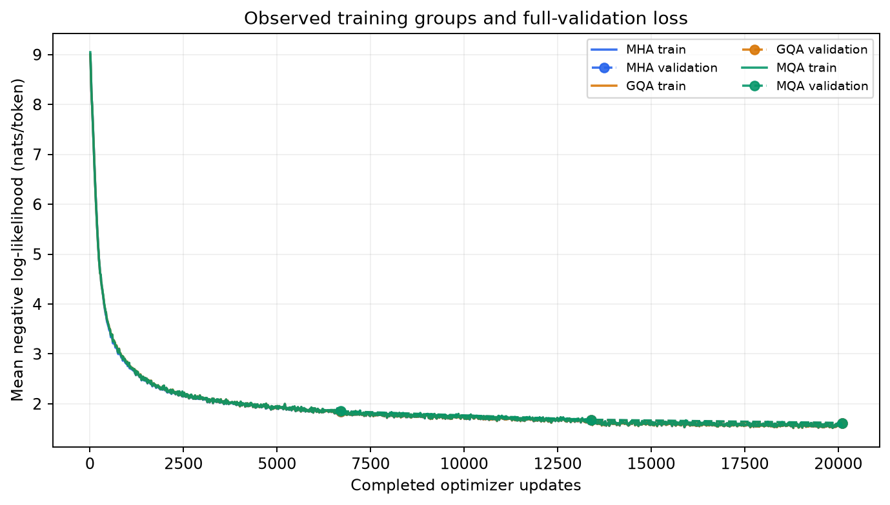
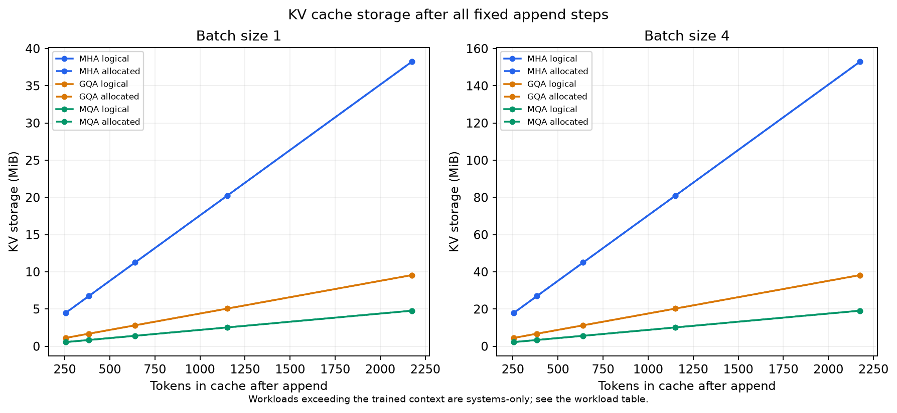
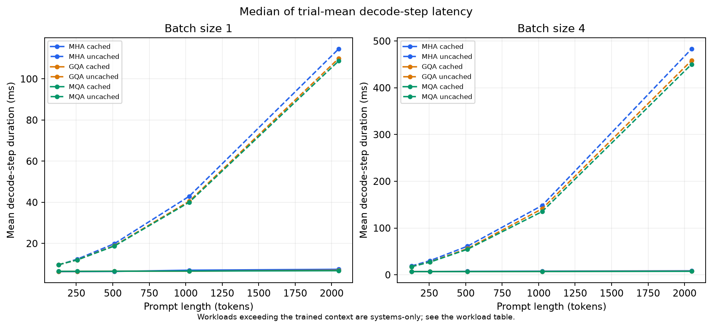

# Can a language model remember less and still predict well?

In this experiment, a model that shared more of its short-term memory predicted the next piece of text almost as well as the usual design, while using 75% less space for that memory. Sharing even more saved 87.5%, with a small drop in measured prediction quality. The memory savings were clear; the speed changes depended on how much text the model processed at once. These are results from three small models trained on one laptop, not a verdict on every language model.

Imagine eight readers working through a story. Each asks different questions about what has happened. In the usual design, each reader keeps a separate set of notes. In the middle design, groups of readers share two sets of notes. In the most compact design, all eight share one set. They can still ask different questions, but they have fewer separate notes to consult.

Those designs are called **multi-head attention (MHA)**, **grouped-query attention (GQA)**, and **multi-query attention (MQA)**. The reusable notes are the **KV cache**: stored information about earlier text that lets the model continue without recalculating everything it has already read. A **token** is a piece of text, sometimes a word and sometimes only part of one. Sharing the notes and reusing the notes are separate choices.

The three models learned from the same 250,000 short synthetic stories. Each made three passes through the training material and received the same 164,637,696 next-token training targets. They were tested on 10,995 different stories. Their basic shape and training recipe matched, although sharing notes also reduced their learned parameter counts from about 13.77 million to 12.44 million and 12.22 million. [Training configuration](../results/run_001/config/experiment.json), [data splits](../results/run_001/data_manifest/splits.json), [measured results](../results/run_001/quality.csv).

The prediction score is called **perplexity**. Lower is better within this experiment; it is not an accuracy percentage or a direct score for storytelling.

| Design | Test perplexity | KV-cache space compared with MHA |
|---|---:|---:|
| MHA: eight sets of notes | 5.02663 | 100% |
| GQA: two shared sets | 5.02467 | 25% |
| MQA: one shared set | 5.05913 | 12.5% |

Source: [quality table](../results/run_001/quality.csv) and [storage measurements](../results/run_001/quality_cost.csv).

GQA's score was just 0.039% lower than MHA's—too small to call a reliable improvement from one training attempt per design. “Almost the same measured prediction quality” is the appropriate reading. MQA's score was 0.6465% higher. The experiment shows a small trade-off here; it cannot tell us whether users would notice it in a different task.

In this chart, lower means better prediction, and moving right means more training. All three models learned at a similar pace. The large dots measure performance on validation text withheld from training. Those scores were still improving at the final dot, so the experiment does not show that learning had finished. The lines overlap too closely to judge tiny differences by eye. [Saved training measurements](../results/run_001/models/gqa/metrics.csv).

The blue, orange, and green lines show the memory needed for the three designs' notes. Longer text requires more storage, but sharing keeps the orange and green lines much lower. For four sequences with 640 tokens retained each, the caches used 45 MiB for MHA, 11.25 MiB for GQA, and 5.625 MiB for MQA. MiB is a unit of memory. These savings apply to the KV cache only: the model's learned weights, other calculations, and the rest of the computer still use memory. [Storage table](../results/run_001/quality_cost.csv).

Reusing the notes delivered the larger speed gain. For four sequences, each starting with a 512-token prompt and continuing for 128 steps, the average step took about 7.443 milliseconds with MHA's cache, 6.811 with GQA's, and 6.885 with MQA's. Without reuse, the same designs took 61.146, 56.030, and 54.585 milliseconds. That is roughly eight times faster with caching in this workload. Each step advances all four sequences; these timings exclude the initial prompt-reading pass. [Timing table](../results/run_001/quality_cost.csv).

The steep dashed lines show the growing cost of rereading everything at every step. The flatter solid lines show the benefit of keeping reusable notes. A smaller cache did not always mean faster work: MHA was slightly faster for one sequence at the shorter prompt lengths. Prompts of 1,024 and 2,048 tokens also went beyond the length used during training once continuation was included. Those points test execution speed, not whether the models understand longer stories well.

The measurements used five warm-ups followed by twenty recorded trials per condition, and checks confirmed that reusing the cache preserved the models' predictions within the numerical tolerance. Timing still varied with execution order and machine state. During the largest MHA workload, recorded system swap usage rose from about 1,780 to 3,744 MiB. This shows memory pressure changed; it does not identify the cause of a particular slow trial. [Benchmark audit](../results/run_001/benchmark_audit.json).

The generated stories also reveal limits. A [GQA example](../results/run_001/generation/gqa_9b2c948b485a.json) repeats box-pushing actions, an [MHA example](../results/run_001/generation/mha_0655a80d680d.json) drifts from a broken bridge to a fence, and an [MQA example](../results/run_001/generation/mqa_4355824052c5.json) confuses who should ask the parents for help. These examples illustrate problems; they do not rank the designs. Their fixed length limit also cuts some stories off mid-sentence.

GQA is a promising choice for further testing in this setup: much smaller cached notes, almost unchanged measured prediction quality, and modest speed gains in several workloads. Confidence beyond this setting requires more training seeds, broader text, and fresh timing comparisons. The reports reuse saved evidence and did not run the models again. The [technical report](technical-report.md) explains the methods and limitations, and the [results index](../results/run_001/README.md) links the inspectable records.
